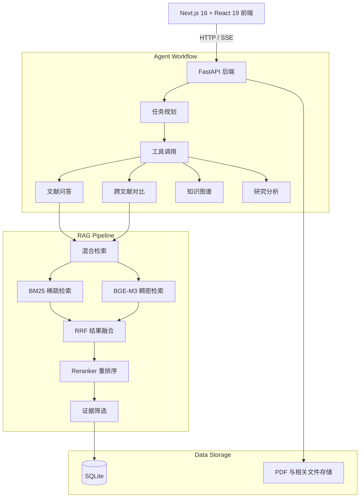

# 研途智研 ResearchPilot 🚀

> **AI4S 时代的智能科研助手 Agent** —— 面向科研论文阅读、检索、分析与学术辅助的智能系统。

## 📖 一、项目简介

**ResearchPilot（研途智研）** 是一款面向科研场景的 AI 论文阅读与分析辅助系统，旨在解决科研人员在文献管理、长文本阅读、知识检索、跨文献对比和研究思路整理等方面的效率问题。

系统融合大语言模型（LLM）、检索增强生成（RAG）和 Agent 工具调用能力，采用前后端分离架构，构建从论文导入、内容解析、智能问答到跨文献分析的科研辅助工作流。

项目重点关注检索结果的相关性、回答的证据支撑以及多步骤科研任务的自动化处理，帮助用户更加高效地理解和利用科研文献。

## ✨ 二、核心功能

### 1. 📄 多模态文献解析与管理

- 支持 PDF 科研论文上传、解析和管理。
- 提取论文文本及相关页面信息。
- 结合 PDF 解析与 OCR 能力处理文献内容。
- 支持论文库管理、重复文献识别及文献阅读。
- 为后续检索、问答和分析提供结构化文本基础。

### 2. 🔍 混合检索与证据问答

构建融合关键词检索与向量检索的 RAG 流程：

- **BM25 稀疏检索**：利用关键词匹配获取相关文献片段。
- **BGE-M3 稠密检索**：利用语义向量表示进行相关性检索。
- **RRF 结果融合**：融合不同检索方式的候选结果。
- **Reranker 重排序**：进一步评估候选文本与问题之间的相关性。
- **证据约束回答**：结合检索到的文献内容生成回答，降低无依据回答的风险。

### 3. 🧠 Agent 智能任务处理

- 根据用户问题识别任务目标。
- 对复杂任务进行步骤规划。
- 根据任务需要调用相应工具。
- 展示 Agent 执行过程中的思考、操作和结果信息。
- 支持科研文献查询、分析及辅助处理工作流。

### 4. 📊 跨文献证据对比

支持对多篇论文进行联合分析，重点包括：

- 核心创新点对比。
- 研究方法与技术路线对比。
- 实验结果对比。
- 不同研究之间的技术联系与演进关系。
- 基于多篇文献证据形成综合分析。

### 5. 🕸️ 文献知识关联与图谱展示

- 展示论文之间的关联信息。
- 辅助发现相关研究主题。
- 结合图谱可视化呈现知识关系。
- 为科研人员梳理领域研究脉络提供辅助。

### 6. 🌐 学术阅读与翻译辅助

- 支持论文阅读界面。
- 提供文献内容问答。
- 支持论文内容翻译。
- 提供相关引用和证据查看能力。
- 辅助用户理解专业术语和复杂研究内容。

### 7. ✍️ 学术写作与数据可视化

- 提供学术写作辅助。
- 支持 CSV 数据处理与图表展示。
- 辅助整理研究思路和写作框架。
- 为科研成果分析提供可视化支持。

### 8. 🔄 论文版本与研究方向分析

- 辅助分析论文不同版本之间的内容变化。
- 整理相关研究的技术路线。
- 辅助提取研究中的问题与未来工作方向。

## 🏗️ 三、系统技术架构

系统采用前后端分离架构，以 FastAPI 提供后端服务，以 Next.js 构建前端交互界面。



## 🛠️ 四、技术栈

| 技术领域 | 使用技术 |
|---|---|
| 前端框架 | Next.js 16 |
| 前端界面 | React 19、TypeScript |
| 样式与组件 | Tailwind CSS、shadcn |
| 数据可视化 | ECharts |
| 前端状态管理 | Zustand |
| PDF 阅读 | PDF.js、React PDF |
| 后端框架 | Python、FastAPI |
| 数据校验 | Pydantic |
| 数据存储 | SQLite |
| PDF 解析 | PyMuPDF |
| OCR | RapidOCR |
| 稀疏检索 | BM25 |
| 稠密检索 | BGE-M3 |
| 检索融合 | RRF |
| 重排序 | Cross-Encoder / Reranker |
| 图关系处理 | NetworkX |
| 深度学习框架 | PyTorch、Transformers |
| AI 能力 | LLM、RAG、Agent 工具调用 |

## 📁 五、项目目录结构

```text
yantu-agent/
│
├── backend/
│   ├── main.py
│   ├── requirements.txt
│   ├── Dockerfile
│   ├── docker-compose.yml
│   └── tests/
│       ├── smoke_test.py
│       ├── test_agent_tool_validation.py
│       ├── test_upload_rollback.py
│       └── cross_paper_eval/
│           ├── 实验数据集
│           ├── 检索评估脚本
│           ├── 重排序实验
│           └── 实验分析结果
│
├── frontend/
│   ├── app/
│   │   ├── page.tsx
│   │   ├── library/
│   │   ├── reader/
│   │   ├── compare/
│   │   ├── graph/
│   │   └── copilot/
│   ├── components/
│   ├── lib/
│   ├── package.json
│   └── next.config.ts
│
├── .gitignore
└── README.md
```

## 🚀 六、本地运行指南

### 运行环境

建议准备以下环境：

- Windows 10 / Windows 11 或 Linux
- Python 3.11
- Node.js
- npm
- 可用的大语言模型服务及相应 API 配置

### 1. 启动后端

进入项目后端目录：

```powershell
cd backend
```

创建 Python 虚拟环境：

```powershell
python -m venv venv
```

激活虚拟环境：

```powershell
.\venv\Scripts\Activate.ps1
```

安装依赖：

```powershell
pip install -r requirements.txt
```

根据项目实际配置创建并填写：

```text
backend/.env
```

配置所需的模型服务、API 密钥及其他运行参数。

启动后端：

```powershell
uvicorn main:app --host 127.0.0.1 --port 8000
```

后端健康检查地址：

```text
http://127.0.0.1:8000/api/health
```

### 2. 启动前端

另开一个 PowerShell 终端，进入前端目录：

```powershell
cd frontend
```

安装依赖：

```powershell
npm install
```

在 `frontend` 目录下创建 `.env.local`：

```dotenv
BACKEND_URL=http://127.0.0.1:8000
```

启动前端开发服务器：

```powershell
npm run dev
```

浏览器访问：

```text
http://localhost:3000
```

## 🧪 七、测试与质量验证

### 1. 后端自动化测试

进入 `backend` 目录，激活虚拟环境后执行