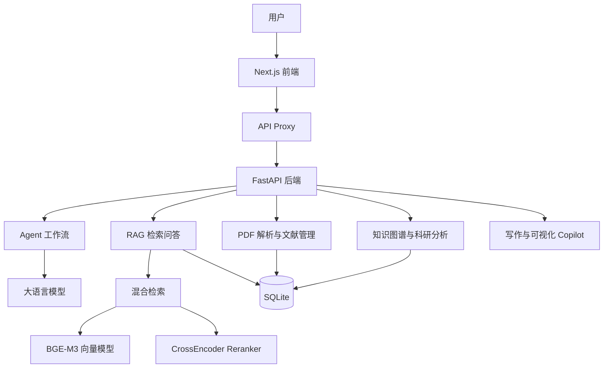
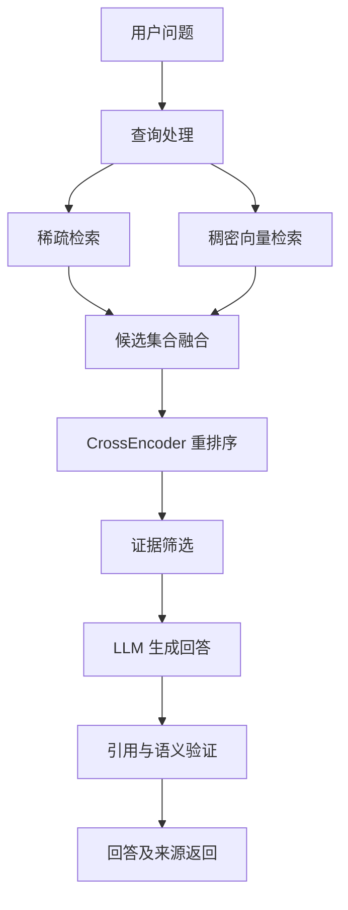

# ResearchPilot 系统架构说明

## 1. 项目概述

ResearchPilot（研途智研）是一款面向科研人员的 AI 论文阅读与研究辅助系统。

系统以大语言模型和 Agent 架构为核心，结合 PDF 解析、混合检索、重排序、RAG、多文推理和科研可视化能力，构建从论文管理、阅读理解到研究分析和写作辅助的工作流程。

## 2. 总体架构

系统采用前后端分离架构。

## 3. 前端架构

技术栈：

- Next.js
- React
- TypeScript
- Tailwind CSS
- shadcn/ui
- ECharts

主要功能页面：

| 页面 | 功能 |
|---|---|
| Dashboard | Agent 对话与任务执行 |
| Library | 论文上传、管理与去重 |
| Reader | PDF 阅读、翻译与证据问答 |
| Compare | 跨论文证据对比 |
| Graph | 文献关系与研究方向分析 |
| Copilot | 写作辅助与数据可视化 |

前端通过同源 API Proxy 转发请求至 FastAPI 后端，并使用 SSE 展示 Agent 执行过程和流式结果。

## 4. 后端架构

技术栈：

- Python 3.11
- FastAPI
- SQLite
- PyMuPDF
- Sentence Transformers

后端主要职责：

1. 用户认证与权限相关接口。
2. PDF 上传、解析及文献管理。
3. 文本切分、向量生成与索引。
4. 检索、重排序和证据问答。
5. Agent 工具调用与任务编排。
6. 多论文对比、知识图谱和 Future Work 分析。
7. SSE 流式响应。

## 5. RAG 检索流程

主要技术：

- BGE-M3：生成文本向量。
- BM25：稀疏关键词检索。
- RRF：融合不同检索结果。
- CrossEncoder：对候选片段进行相关性重排序。
- Evidence Validation：检查证据结构、引用 ID 和语义支持情况。

## 6. Agent 工作流

Agent 根据用户输入识别任务目标，并选择相应工具或处理流程。

主要能力：

- 文献库统计与查询
- 论文检索与阅读
- 单篇论文问答
- 多论文对比
- 文献综述
- 知识图谱分析
- Future Work 分析

执行过程通过 SSE 返回，前端展示思考、工具调用、观察结果及最终回答等步骤。

## 7. 数据存储

系统使用 SQLite 保存业务数据。

主要数据包括：

- 用户信息
- 论文元数据
- PDF 页面文本
- 文本 Chunk
- 向量数据
- 相关分析结果

Docker 部署使用命名卷 `researchpilot-data` 持久化应用数据。

## 8. 模型与外部服务

| 组件 | 用途 |
|---|---|
| DeepSeek API | 大语言模型推理 |
| BGE-M3 | 文本向量化 |
| BGE Reranker | 检索结果重排序 |
| PyMuPDF | PDF 文本解析 |

模型路径和 API 配置通过环境变量管理，不应将密钥写入代码或公开仓库。

## 9. 部署架构

本地部署由以下组件组成：

- Next.js 前端服务
- FastAPI 后端容器
- SQLite 数据存储
- 本地向量模型
- 本地 Reranker 模型
- 外部大语言模型 API

Docker Compose 负责后端容器构建、启动、模型挂载和数据持久化。

## 10. 架构特点

1. 前后端分离，便于独立开发和部署。
2. Agent 工具编排，支持多种科研任务。
3. 混合检索与重排序，提高证据检索能力。
4. 证据引用验证，降低无依据回答风险。
5. SSE 流式输出，提升交互体验。
6. 模型与密钥配置外置，便于环境迁移和安全管理。